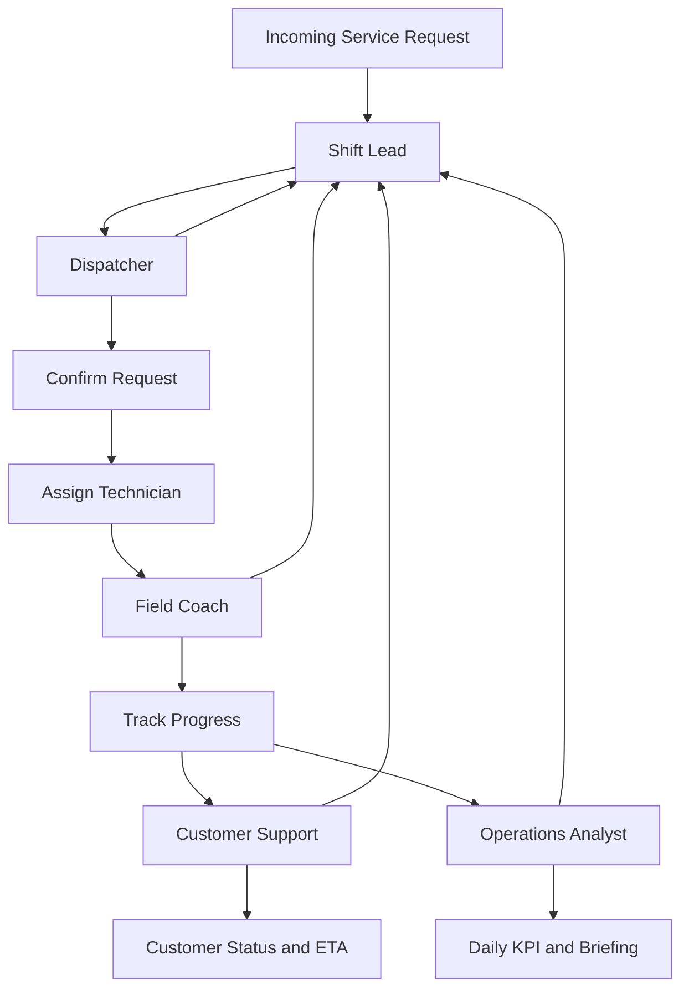

# DARFIX Agents — how they communicate

Multi-agent crew that operates the DARFIX home-maintenance API. **One shared backend**; role-scoped tools; sensitive actions need Shift Lead approval.

## Communication

Pipeline is **sequential**, then specialists **report back** to Shift Lead:



1. Request hits **Shift Lead**.
2. Lead hands off to **Dispatcher** → confirm → assign **independent technician** (named) **or** **maintenance company pool** (org then names a tech).
3. **Field Coach** tracks progress after a named technician is on the job.
4. From progress, **Customer Support** covers status/ETA and **Ops Analyst** updates KPIs.
5. Dispatcher, Field Coach, Support, and Ops Analyst all report results back to Shift Lead.

All agents connect to the **same DARFIX API** — no separate operational stores.

## API tool access

| Agent | Directory | API permissions |
| --- | --- | --- |
| Shift Lead | `shift-lead/` | Health, queue/overview (read), list/decide approvals, peer coordination |
| Dispatcher | `dispatcher/` | Queue, confirm, first-time assign; propose reassign |
| Customer Support | `customer-support/` | Customer status / ETA; propose customer commitments |
| Field Coach | `field-coach/` | My jobs, field updates, notes, checklists |
| Ops Analyst | `ops-analyst/` | Queue, overview, KPI (read-only) |

**Autonomous:** confirm, first assign, field progress, read status.  
**Needs Shift Lead approval:** cancel, reassign, customer commitments.

## Run

```bash
# Terminal 1 — DARFIX API
cd ../darfix && npm run dev

# Terminal 2 — mount all peers together (required for Shift Lead peer links)
cd ../darfix-agents
npx @grok/agent-sdk dev .
# Playgrounds: http://127.0.0.1:3000/shift-lead  (+ /dispatcher, /customer-support, …)
```

Requires Cursor login / API key for model turns. Tool-only checks:

```bash
npx @grok/agent-sdk validate --dir .
npx @grok/agent-sdk tool call darfix_health --dir ./dispatcher --input '{}'
```

See `shared/permissions.md`. Legacy folder `../darfix-ops-crew` redirects here.
