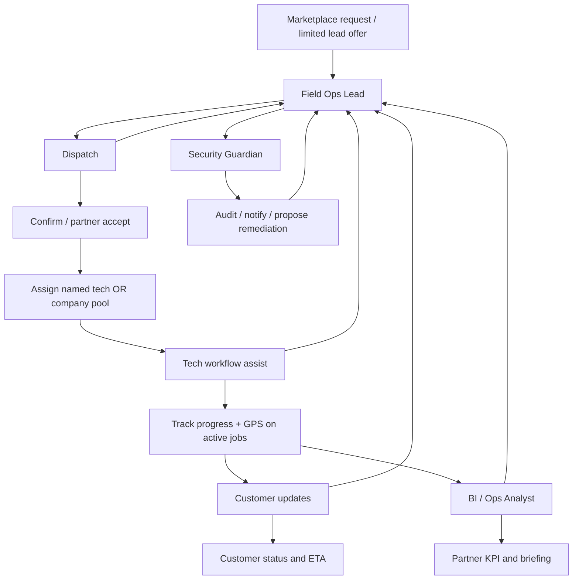

# DARFIX Agents — AI Control Tower / Field Ops

Multi-agent **AI Control Tower** that serves **partner maintenance companies** on the DARFIX Growth OS (not DARFIX-as-operator). One shared backend; role-scoped tools; sensitive actions need human approval via Field Ops lead.

## Framing

| Legacy name | Control Tower role | Serves |
| --- | --- | --- |
| Shift Lead | **Field Ops lead** | Partner company ops — approvals, escalations, policy |
| Dispatcher | **Dispatch** | Limited lead → confirm → assign named tech or company pool |
| Field Coach | **Tech workflow assist** | Progress, checklist, notes after named tech is on the job |
| Customer Support | **Customer updates** | Status / ETA commitments (approval-gated) |
| Ops Analyst | **BI** | Partner KPI briefings, fill-rate, SLA mix |

Approval gates stay: **cancel, reassign, price/quote disputes, customer commitments** need Field Ops (Shift Lead) approval. Auto reminds/alerts are recommendations — humans decide.

## Communication

Pipeline is **sequential**, then specialists **report back** to Field Ops lead:



1. Request hits **Field Ops lead** (Shift Lead).
2. Hand-off to **Dispatch** → confirm → assign independent **or** partner company pool (org then names a tech). Leads are **exclusive or limited (1–3)** with deadlines — not blast-to-all.
3. **Tech workflow assist** (Field Coach) tracks progress after a named technician accepts.
4. **Customer updates** + **BI** report results back to Field Ops lead.

All agents connect to the **same DARFIX API** — partner SaaS + demand marketplace.

## API tool access

| Agent | Directory | API permissions |
| --- | --- | --- |
| Field Ops lead (Shift Lead) | `shift-lead/` | Health, queue/overview (read), list/decide approvals, peer coordination |
| Dispatch | `dispatcher/` | Queue, confirm, first-time assign; propose reassign |
| Customer updates | `customer-support/` | Customer status / ETA; propose customer commitments |
| Tech workflow assist | `field-coach/` | My jobs, field updates, notes, checklists |
| BI | `ops-analyst/` | Queue, overview, KPI (read-only) |
| Growth / campaigns | `growth-marketer/` | Seasonal Saudi campaign drafts (never auto-publish ads) |
| **Security Guardian** | `security-guardian/` | Continuous audits, threat notify, approval-gated remediations (FE/BE/agents) |
| **Dev.Ag** | `dev-ag/` | UI/UX + FE/BE gap exploration and product-quality reports |

**Autonomous:** confirm, first assign, field progress, read status, security *audits* + notifications.  
**Needs Field Ops / admin approval:** cancel, reassign, customer commitments, **security remediations**.  
**Needs marketing approval:** any paid ad or live promo from Growth Marketer.

Agent logins use env credentials only (`DARFIX_ADMIN_EMAIL` / `DARFIX_ADMIN_PASSWORD`, etc.) — never hardcoded demo passwords.

## Run

```bash
# Terminal 1 — DARFIX API
cd ../darfix && npm run dev

# Terminal 2 — mount all peers together (required for Shift Lead peer links)
cd ../darfix-agents
npx @grok/agent-sdk dev .
# Playgrounds: http://127.0.0.1:3000/shift-lead  (+ /dispatcher, /customer-support, …)
```

Requires Cursor login / API key for model turns. Tool-only checks:

```bash
npx @grok/agent-sdk validate --dir .
npx @grok/agent-sdk tool call darfix_health --dir ./dispatcher --input '{}'
```

See `shared/permissions.md`. Legacy folder `../darfix-ops-crew` redirects here.
